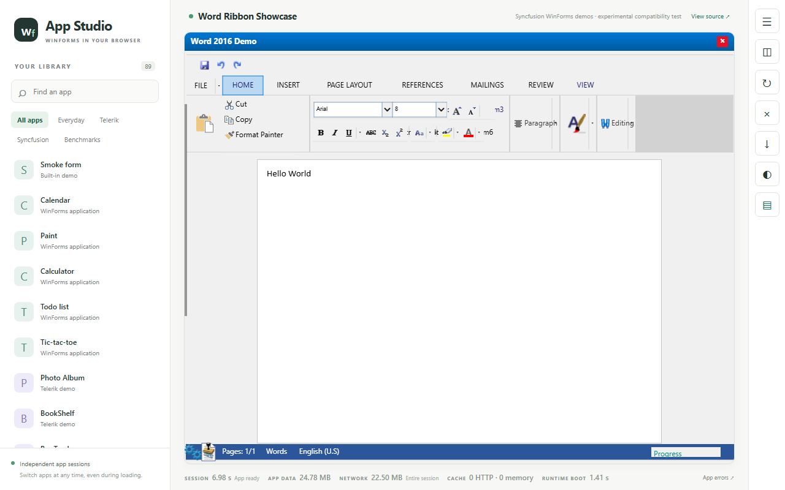
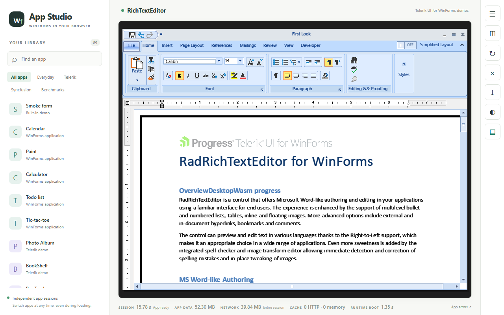
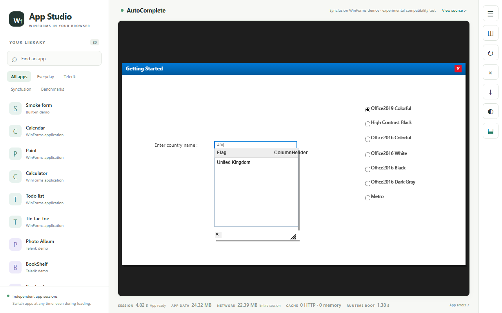
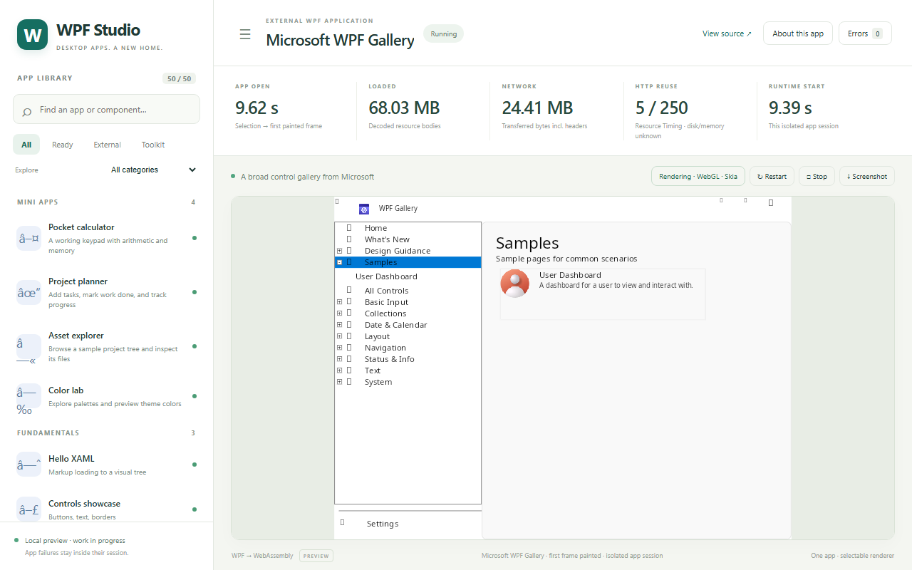
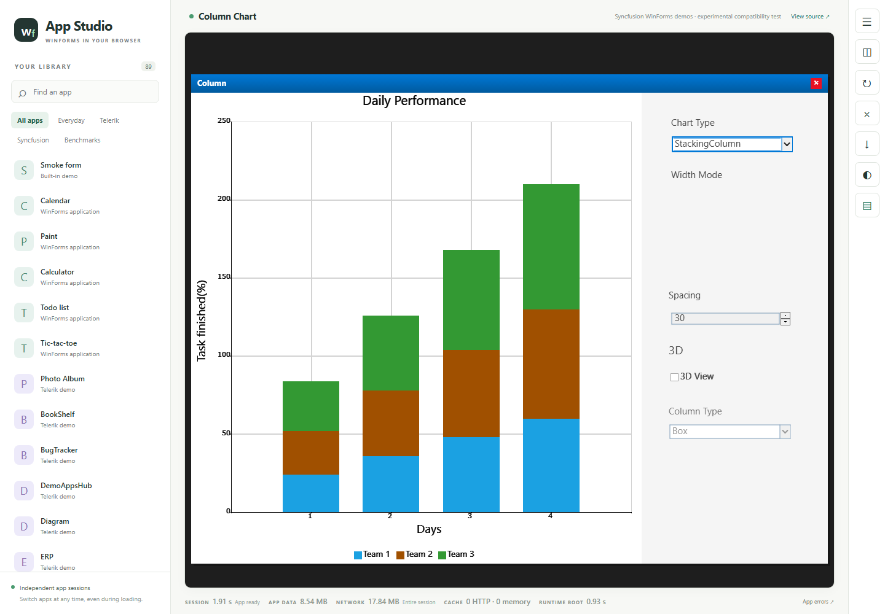
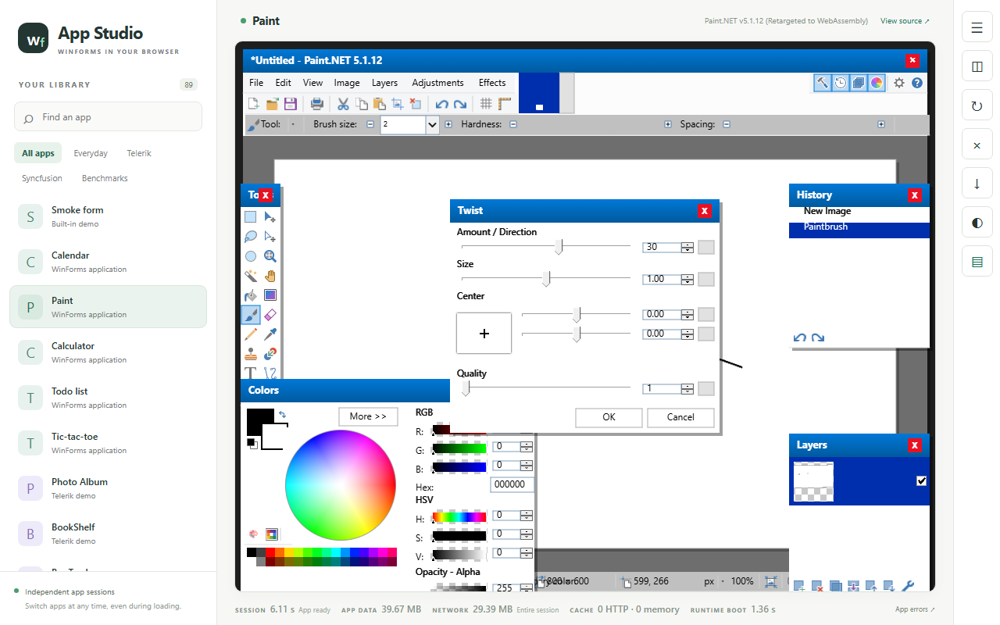

# DesktopWasm — WinForms and WPF applications on WebAssembly

One workspace, one catalog, and one launcher for WinForms and WPF
applications running on WebAssembly. Real mixed-framework hosting (both UI
stacks inside one app session) is work in progress.

**Working demos (screenshots of tested builds, staged vs public labeled):**

| | |
|---|---|
| <a href="docs/progress/images/word-type-public-gen43.png"></a><br/>**Word 2016 (public)** — typed “Hello World” at the doc origin | <a href="docs/progress/images/rte-type-shell63.png"></a><br/>**Telerik RichTextEditor (staged)** — typed text inserted in the document |
| <a href="docs/progress/images/sf01-popup-shell63.png"></a><br/>**Syncfusion AutoComplete (staged)** — typing “Uni” opened the United Kingdom suggestion | <a href="docs/progress/images/wpf-nav-shell63.png"></a><br/>**WPF Gallery (staged)** — tree selection navigated to the sample page |
| <a href="docs/progress/images/01-chart-stacking-column.png"></a><br/>**Syncfusion Chart (staged)** — ChartType pick repainted stacked columns | <a href="docs/progress/images/paint-twist-shell63.png"></a><br/>**Paint.NET 5.1.12 (staged)** — stroke drawn, Twist dialog opened (effect output still unverified) |

Full scope, remaining limitations, and attribution: [progress 2026-11-03](docs/progress/2026-11-03.md).

Origin: this repository is the successor of
[winforms-wasm](https://github.com/RazvanManolache/winforms-wasm). Standalone
WinForms development ends at that repository's final checkpoint; future
development and releases happen here.

## Status (honest)

- The unified catalog (`catalog/apps.json`) lists 140 entries across both
  families with provenance and per-entry availability. Entries whose inputs
  are not staged in a given checkout report `missing-input`,
  `not-converted`, or `unavailable` — never ready. A source-only clone
  therefore launches no converted upstream app until its inputs are staged
  (see `inputs/README.md`).
- Pure-framework paths are the proven slice. Mixed sessions, full control
  parity, and performance work remain open and are tracked as gaps, not
  claims. This repository publishes no release tags and no binary assets;
  the initial commit is a source snapshot, and any future release will be
  cut explicitly — never implied by this checkout.

## Layout

- `src/DesktopWasm.AppModel/` — catalog/package/session contracts, no engine
  dependency.
- `src/DesktopWasm.Catalog/` — one app registry, validation, legacy import
  adapters, deterministic JSON.
- `src/DesktopWasm.Catalog.Tool/` — `import` (frozen sources → catalog),
  `verify` (drift check), `refresh` (staging receipts → availability).
- `src/DesktopWasm.Interop/`, `src/DesktopWasm.Packaging/` — mixed-session
  adapters and the joint conversion closure.
- `src/DesktopWasm.Host.Server/`, `src/DesktopWasm.Web/` — one public
  catalog API/launcher (serves the unified registry).
- `src/WfWasm.*`, `src/DesktopWasm.{BrowserHost,Convert,Core,Graphics,Wpf}`,
  `src/Microsoft.Win32.SystemEvents/` — imported first-party engines and
  hosts (names preserved).
- `tests/` — imported suites plus catalog/package/mixed-runtime tests.
- `catalog/` — `apps.json` (authoritative registry), `apps.schema.json`,
  `conflict-map.json`, `sources/` (redacted extraction receipts).
- `scripts/{unified,winforms,wpf}/` — relocatable build/packaging scripts.
- `docs/architecture/` — `UNIFICATION.md`, `CATALOG-CONTRACT.md`.
- `docs/progress/` — dated progress pages with screenshot evidence.
- `inputs/winforms/runtimes/` — required .NET WinForms fork source and
  resources (MIT, see `inputs/README.md`). Shipped as source; its binaries
  are never included.
- `inputs/` (everything else) — NOT shipped: optional app closures,
  commercial/vendor trees and generated binaries are excluded (see
  `inputs/README.md`).

## Source-only build

Requires the .NET 9+ SDK plus the `wasm-tools` workload for the browser
hosts (`dotnet workload install wasm-tools`). No other bootstrap is needed;
NuGet restore fetches declared packages separately.

```powershell
dotnet build DesktopWasm.slnx
dotnet test tests/DesktopWasm.Catalog.Tests/DesktopWasm.Catalog.Tests.csproj
```

Build evidence for publication is produced from staged-export trees like
this one. The project-local `.tools` interpreter is not shipped: a
plain source build needs no Python, but the optional packaging step
(static precompression of served assets) requires a standalone CPython
3.14 at the repo-relative path `.tools/python314/python.exe`, with
Brotli installed for that interpreter. A virtualenv or global Python
does not satisfy the packaging resolver. One-time setup from the repo
root, after installing the official Python install manager from
[python.org](https://www.python.org/downloads/) (see the
[official Windows runtime documentation](https://docs.python.org/3.14/using/windows.html#installing-runtimes)):
no global registration is needed — the `--target` option extracts the
runtime to the chosen directory:

```powershell
py install --target .tools/python314 3.14
& ./.tools/python314/python.exe -m ensurepip --upgrade
& ./.tools/python314/python.exe -m pip install Brotli
& ./scripts/shell/Resolve-LocalPython.ps1
```

Bootstrapping needs the installer/manager, but all project Python
execution is the qualified local exe — no runtime binaries are
shipped. This is documented setup, not a claim that a fresh-machine
installer was tested here; the .NET source build validation above is
the actual tested result.

Optional capabilities are opt-in and never required for a clean build:

- Full WindowsBase / Paint.NET closure:
  `dotnet build -p:DesktopWasmFullWindowsBase=true` (needs
  `inputs/winforms/targets/paint.net`, staged locally, otherwise strict fail).
- Converted preview apps (`ConvertedApps/*`): staging is skipped when the
  inputs are absent; catalog entries stay `missing-input`. No stubs.

See `inputs/README.md` for the optional-input layout and recipes.

## License

First-party code: [MIT](LICENSE) (winforms-wasm contributors). Vendored
browser libraries and upstream references: see
[THIRD-PARTY-NOTICES.md](THIRD-PARTY-NOTICES.md). No third-party application
binaries are distributed here.
