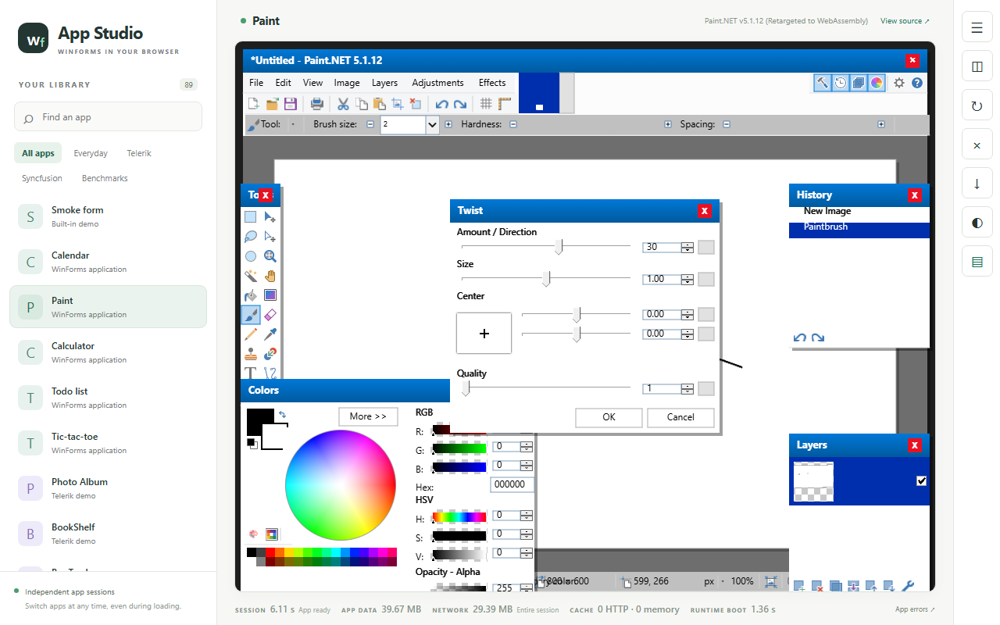
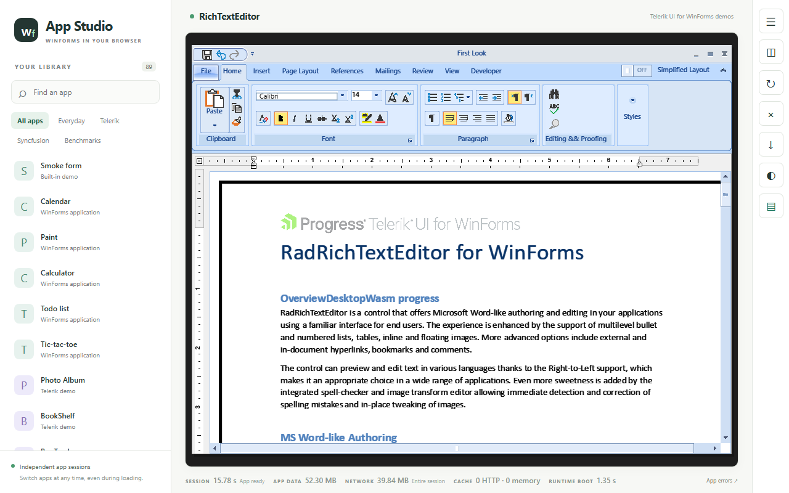
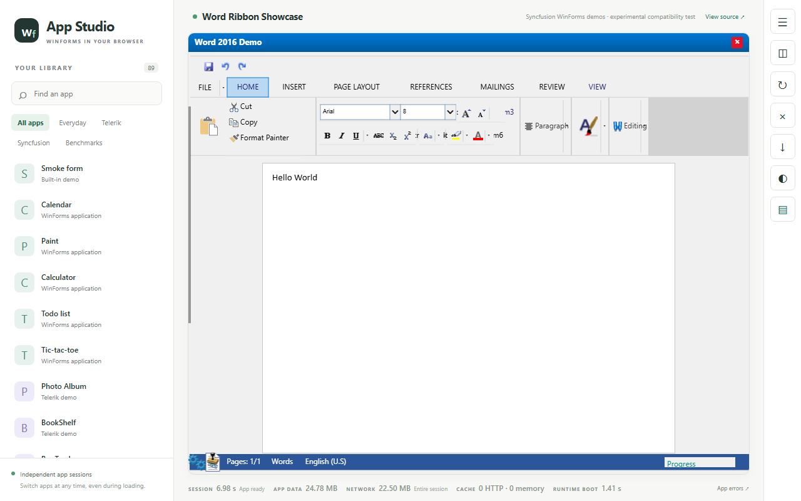
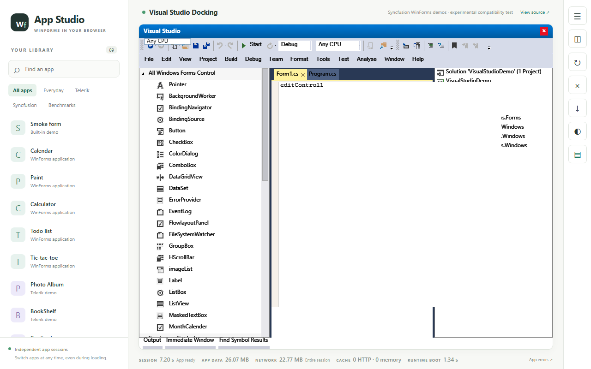
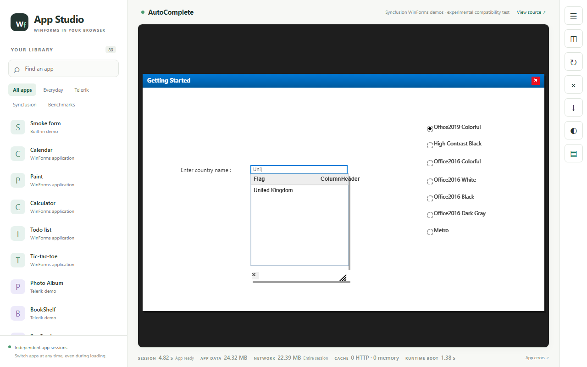
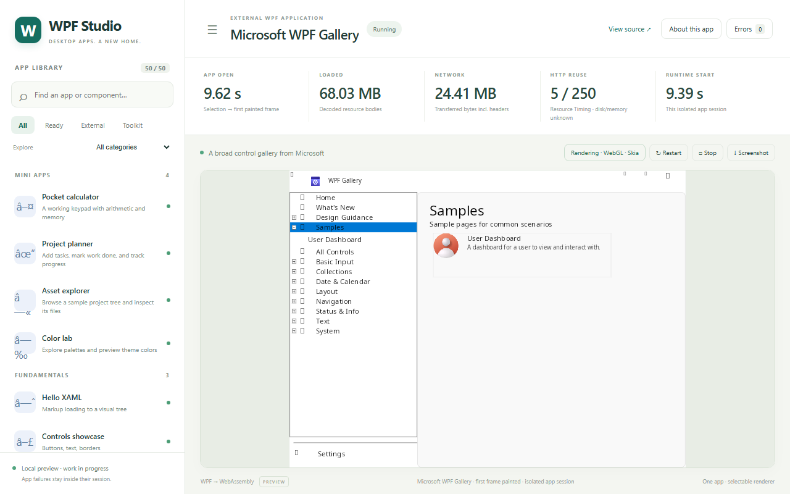
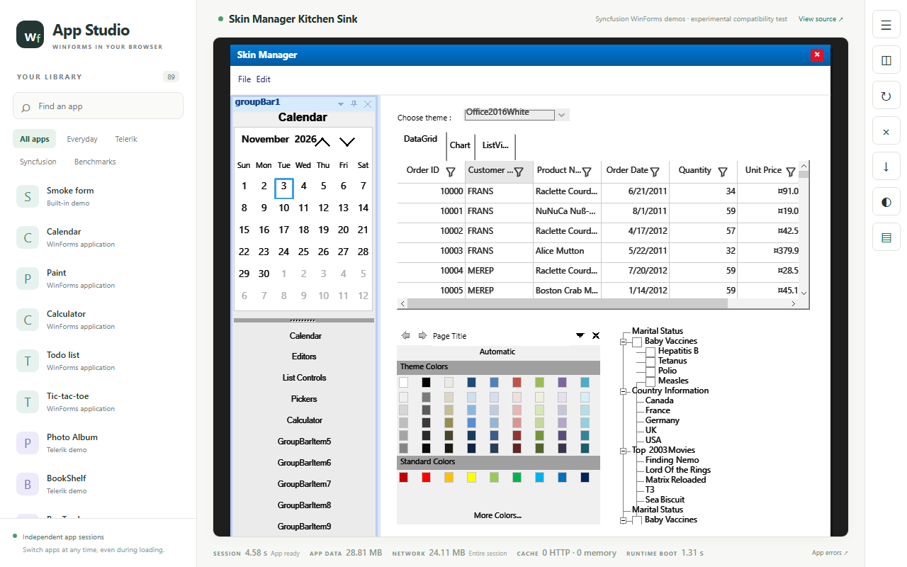
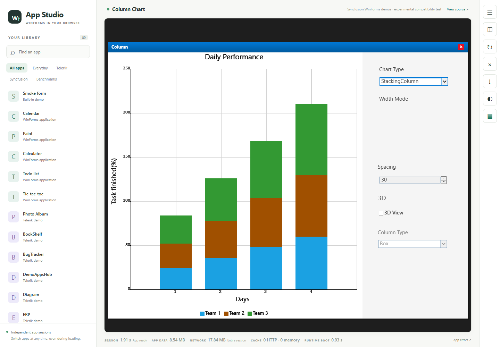

# DesktopWasm progress — 2026-11-03

*Source-only project status with real browser evidence. Screenshots are
actual test captures that illustrate compatibility; they are not
included app binaries or source. Original demo apps belong to their
vendors (Syncfusion/Telerik/Microsoft/dotPDN samples); see notices and
attribution below. A source-only clone launches no converted app until
its licensed inputs are staged (see the main README and `inputs/`).*

## Where we are

One workspace, one catalog (`catalog/apps.json`, 140 entries confirmed
in both the active tree and the staged export), one launcher for
WinForms and WPF applications on WebAssembly. Pure-framework paths are
the proven slice: real applications mount, render, and increasingly
accept input in the browser. Mixed-framework sessions (both stacks
inside one app session), full control parity, and performance work
remain open gaps — tracked below, not claimed.

Three states are distinguished everywhere in this page:

- **Implemented in source** — the fix exists in first-party code with
  unit/integration tests.
- **Browser-verified on a staged generation** — proven by automated
  headless-Chromium probes (held/open/after screenshots, console and
  error capture) against a pinned staged build (shell60/62/63 below).
- **Available on public** — proven against the currently served public
  pair, build43 (`20261103T070020ZAGYshell43`; app bytes `e1bdb2d5`,
  re-pinned unchanged); Word boots 5/5 on it. Staged fixes reach
  public only after an explicit acceptance cutover. Staged-green is
  not public-available.

Capture provenance: full-viewport (1280×800) and probe (1440×1000)
headless-Chromium screenshots, unedited, with per-file hashes in the
capture manifest (2026-11-03T14:55:11Z) and served-log trace evidence
for the probe shots. Viewport and build are stated per image.

## Screenshot gallery

*Paint effects dialog opens — staged `shell63`. Paint.NET 5.1.12
(window title): freehand stroke drawn, then
Effects > Distort > Twist opened (Amount 30, Size 1.00, Center,
Quality 1, OK/Cancel) over live Tools/Colors/History/Layers panels.
The shot proves the dialog opens and paints; it does not prove the
final effect pixels or Undo.*

*Typing lands in the rich-text editor — staged `shell63`. Clicking
into the document and typing inserted “DesktopWasm progress” directly
after “Overview”, with zero page errors.*

*Word types on public — public `build43`. The Syncfusion Word 2016
demo booted on the live public pair and typed the exact string “Hello
World” at the document origin (status bar: Pages 1/1, English (U.S.)).*

*Docking demo boots — staged `shell63`. The VS-style designer renders
with toolbox, Solution Explorer, Properties, and Output panels.
Toolbox clicks are no-ops on current bytes, so this is a boot/render
result, not a fully functional designer claim.*

*AutoComplete suggests — staged `shell63`. Typing “Uni” opened the
suggestion popup with the United Kingdom row visible, zero page
errors.*

*WPF navigation works — staged `shell63`. Tree-selecting the Samples
node in the WPF Gallery navigated the content pane to the sample page
(first frame ~9.6 s in the harness), zero page errors.*

*Theme value commits without reskin — staged `shell63`. Opening the
Choose-theme list and clicking the Office2016White row committed the
value in the box, but the form did not visibly reskin (same on
public).*

*ChartType commit repaints the chart — staged `shell60` (served-log
commit line). The popup pick committed StackingColumn and the chart
repainted from grouped to stacked columns.*

## Status table (concise)

Original Syncfusion demos plus Paint, scrolling runtime (RTE), and
benchmarks. Anything not re-gated on a newer generation keeps its
older verdict — old greens are not silently carried forward.

| Area | Status | Evidence |
|---|---|---|
| SF02 data-grid | Defect reproduced, fix pending | Prior verification (getting-started renders; interaction gap open) |
| SF03 chart ChartType | Staged GREEN (open, commit, repaint, Escape dismiss) on shell60; public not gated | Staged probe traces + gallery repaint shot |
| SF04 diagram nodes | Renders staged + public; node *selection* blocked (missing `GraphicsPath.Widen` widen milestone) | Public + staged probe traces (`NotSupportedException` on every node hit-test) |
| SF01 AutoComplete | Suggestion popup staged GREEN (shell63): “Uni” → United Kingdom row | Staged capture manifest + probe |
| SF05 calendar grid + right controls | Grid select + popups open on public build43 pair; item commit + reskin staged GREEN (shell60/62/63) | Public + staged probes (label sync, served `sflist-selected` lines) |
| SF06 numeric watermark | Defect reproduced; fix in runtime work (not independently verified here) | Runtime reports |
| SF07 skin theme combo | Value commit staged GREEN (shell60 + shell63); visible reskin on shell60/62 but NOT shell63/public; vendor `MultiColumnComboBox` blocked (`Visible=False`) | Gallery shots per generation + control dumps |
| SF10 wizard wrap-around | Wrap-related fork fixes included (DrawString-path wrap proven by causal test, 350/350 suite); served welcome still renders single-row with root cause open; full Next/Back navigation incomplete | Vendor wrap report + served census |
| SF11 smith chart | White surface on public; `Pen.Brush` null root cause fixed in source with unit tests (590/590 drawing suite); served-browser confirmation pending | Public probe trace + drawing unit tests |
| ADGV combo baseline | Public build43 pair shows pre-fix blank box (live-pair captures 2026-11-03); staged combo support previously demonstrated on a retired candidate; re-gate pending on current staged | Live-pair probe shots + prior staged report |
| AE0940 navigation-drawer / multi-column-tree | Form-create traced to managed frames (missing data path; no drive shim in wasm); pending | Prior stack-trace analysis |
| Paint (Paint.NET 5.1.12) | Twist dialog opens over live stroke on staged shell63; effect-apply/Undo unproven | Gallery shot + capture manifest |
| RTE typing | Inserted text verified staged; word-level typing on public build43 | Gallery shots + capture manifest |
| WPF gallery | Tree-select navigates staged; first frame ~9.6 s (single harness observation) | Capture manifest |
| Docking designer | Boots with panels on staged shell63; toolbox clicks no-op | Capture manifest |
| Benchmarks (grid flags/load) | Flags + 100–200 loaded rows render on public build43 pair | Live-pair probe shots |

## Honest limits

- A source-only clone runs no converted app out of the box:
  commercial/vendor inputs are never redistributed and must be staged
  by the user under `inputs/` (see `inputs/README.md`).
- The project-local `.tools` CPython interpreter is not shipped. A
  plain source build needs only the .NET SDK + `wasm-tools`; the
  optional packaging step (static precompression of served assets)
  requires a standalone CPython 3.14 at the repo-relative path
  `.tools/python314/python.exe` with Brotli installed locally — see
  the main README for the portable setup. A virtualenv or global
  Python does not satisfy the packaging resolver.
- Staged-green is not public-available; cutover is explicit per fix.
- Generations move fast: shell63 served the fresh captures while
  shell60/62 evidence stays valid only for its own pinned builds.
  Captions name the exact build; do not mix evidence across builds.
- Unsupported effects, mixed-framework sessions, and some custom
  vendor controls remain open gaps — no arbitrary .NET app or every
  control is implied to work. Explicitly still blocked and not shown
  as proof: Back-row actuation, native combo-dropdown hit-testing,
  Quantize/Twist OK-render pixels, and theme visible reskin on the
  current staged/public builds.
- Timings observed during probing (e.g. session boot, first frames)
  are single-run harness observations, not performance claims.

## Attribution and setup

- Original demo applications are property of their respective vendors
  and are used here solely to illustrate compatibility; no vendor
  source or binaries are distributed (see
  `THIRD-PARTY-NOTICES.md`).
- This repository is the successor of
  [winforms-wasm](https://github.com/RazvanManolache/winforms-wasm);
  WinForms development continues here.
- Build: .NET 9+ SDK plus the `wasm-tools` workload; see the main
  README's source-only build section. Substitute your licensed inputs
  under `inputs/` to stage optional app closures.
