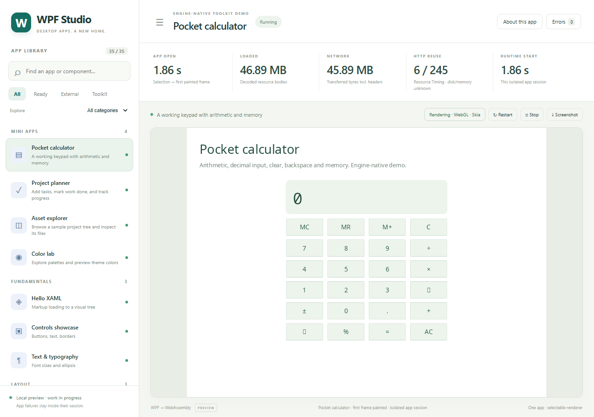
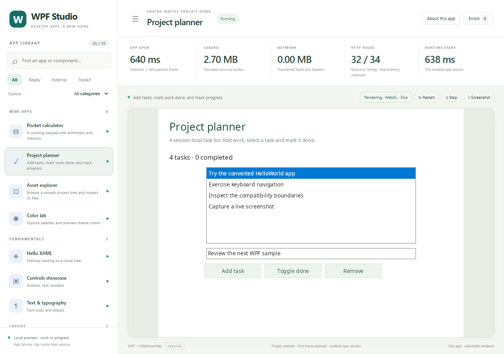
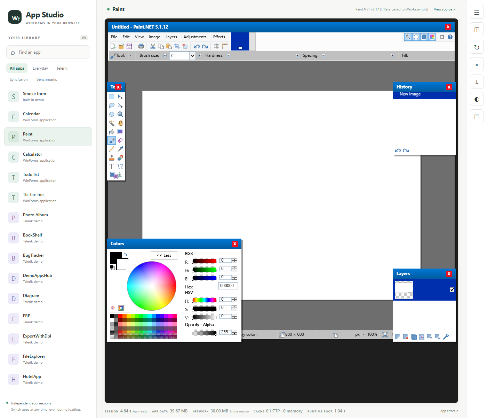
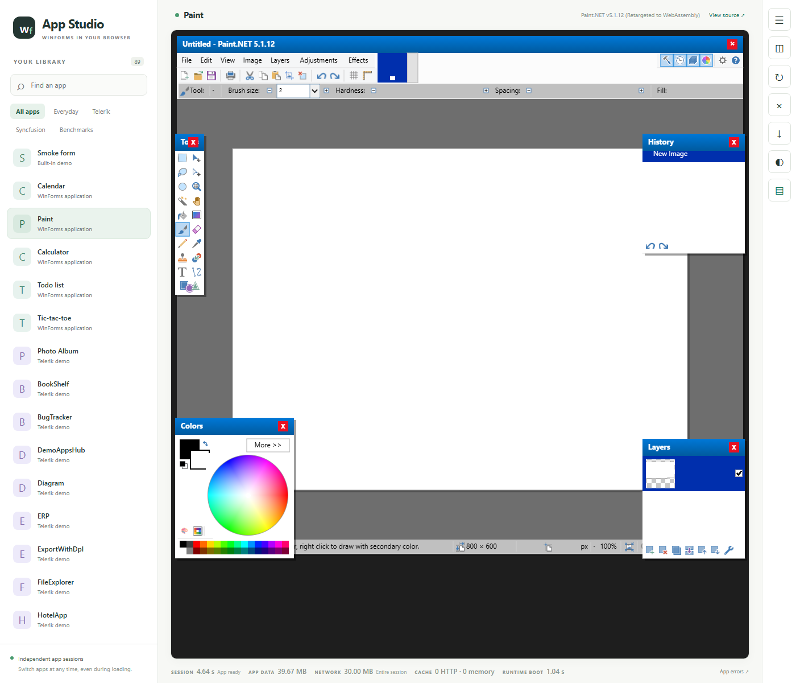

# Compatibility progress — 6 November 2026

This development snapshot includes the cohort's implementation work and direct
integration repairs. It preserves the existing browser build workflow and the
rolling `ci-latest` download policy. It does not mark the whole application
backlog complete.

## Implemented

- Drawing decodes Adam7 interlaced PNG images across supported color/depth
  combinations, with pass-local filtering and regression coverage.
- Character-range measurement returns selection regions. Direct review added
  vertical alignment, layout clipping and prefix shaping; this remains a
  single-line implementation.
- The WinForms host carries clipping fixes for collapsed/hidden controls,
  dropdown ownership, modal keyboard routing, focus and hover tracking,
  scoped wheel invalidation, and reduced idle scroll polling.
- Paint.NET's Colors window now respects its explicit collapsed size on first
  paint. Off-window RGB controls no longer force it open. More/Less was clicked
  in the actual application; the RGB region returned exactly to its collapsed
  pixels with no browser errors. Automatic growth remains available to windows
  that explicitly enable AutoSize.
- Conversion and packaging include dependency closure/resolver repairs,
  Win32 primitive identities, SendMessage forwarding and explicit native gaps.
- WPF package launches use a private assembly context. Resource dictionaries,
  converted type lookup and template bindings preserve their assembly scope.
  Fresh application entry assemblies avoid reusing a previous navigation state.
- Catalog staging provenance now includes file digests for eight prepared
  benchmark entries. OpenPDN, PKHeX and LINQPad retain their observed launch
  gates; preparation alone does not become a successful application claim.
- First-party catalog icons are regenerated from the UTF-8 demo definitions.
- WPF Studio preserves the `/wpf` mount when reading app routes, navigating
  between apps and opening their runtime frames. The converted Microsoft WPF
  Gallery reached its rendered ready state in the fresh local generation.
- Packaged assembly filenames avoid percent escapes, fixing an MSBuild publish
  failure for names containing spaces. Core regression tests cover URI round
  trips, reserved characters and distinct escape-like names.

## Validation and limits

The local integration checks passed Drawing (615), CanvasHost (618), Rewrite
(381), Catalog (144), Core (40), and WinForms (391) against a freshly regenerated
fork. Packaging recorded 93 passes and one existing skipped app acceptance test.
The publication build separately runs the twelve source-only suites in
`scripts/ci/build.ps1`: all 876 tests passed. A headless Chromium check rendered
the calculator and project planner at both `/` and `/wpf`, including navigation
between apps, with no page errors.
These are different evidence sets: several larger integration suites require
private application inputs that are absent from a public clone.
The broader Studio JavaScript file records 11 passes and three missing-input
failures in this source-only checkout; its routing regression passes. It is
separate from the packaged browser checks above.

The full local WPF run recorded 3,395 passes out of 3,396 tests, with the sole
remaining failure described below. The targeted package/resource/navigation
checks separately passed all 20 cases.

Mixed hosting still has an open integration failure: the real AvalonDock joint
package carries the WindowsFormsHost in its layout model but does not yet give
it the required visual pane/parent. Its regression remains enabled. Paint.NET
Quantize apply/worker completion and remaining vendor interaction workflows
also require original-app acceptance; this snapshot does not claim them fixed.

The older [tested demo gallery](2026-11-03.md) remains available. The image below
is from the source-built browser package, not a converted commercial app.

The next pair shows the real Paint.NET Colors window expanded and then
collapsed after clicking Less. It verifies window sizing and clipping; it does
not establish effect execution.

| More | Less |
|---|---|
|  |  |
